<div align="center">

<br>
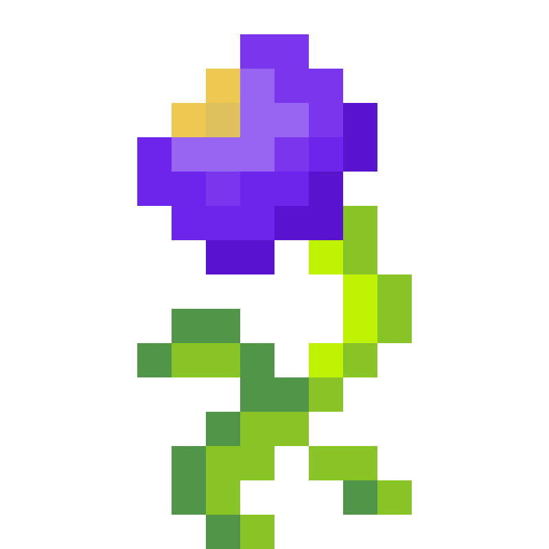
<br>
<br>

<h1>The Roots of Ancient Magic</h1>

<div align="center">

<a href="#install-mod">
  <span style="font-size: 18px;"><b>Завантажити мод</b></span>
</a>

<details>
  <summary style="font-style: italic; font-size: 14px;">English translation</summary>
  <a href="#install-mod-eng">
    <span style="font-size: 18px;"><b>Download the mod</b></span>
  </a>
</details>
<br>

</div>

<h3>Магічний мод для Minecraft на Fabric із шістьма стихіями, маною та унікальною зброєю.</h3>

<p style="font-size: 16px;">
    Мод додає систему мани, стихійні посохи, аксесуари, броню, інструменти та нові біоми.
</p>

<p style="font-size: 14px;">
    Версія гри: Minecraft Java Edition 1.20.1, Fabric.
</p>

<details>
  <summary style="font-style: italic; font-size: 14px;">English translation</summary>
  <h3>A magic Minecraft mod on Fabric with six elements, mana and unique weapons.</h3>

  <p style="font-size: 16px;">
      The mod adds a mana system, elemental staffs, accessories, armor, tools and new biomes.
  </p>

  <p style="font-size: 14px;">
      Game version: Minecraft Java Edition 1.20.1, Fabric.
  </p>
</details>
<br>

</div>

<!--  -->
<div align="center">
    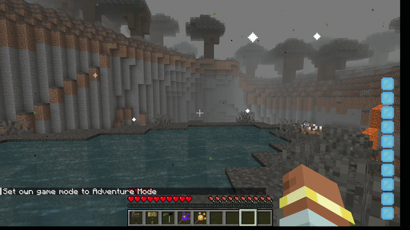
</div>

<div align="center">
    
</div>

<h1 id="top">Навігація</h1>

<ul style="font-size: 18px; line-height: 1.9;">
  <li>
    📁 <a href="#project-structure">Структура проєкту</a>
  </li>
  <li>
    🧠 <a href="#all-modules">Технології проєкту</a>
  </li>
  <li>
    🖥️ <a href="#install-mod">Встановлення мода</a>
    <ul style="font-size: 16px; line-height: 1.6;">
      <li><a href="#ready-jar">Готовий .jar файл</a></li>
      <li><a href="#run-client">Запуск у режимі розробки</a></li>
      <li><a href="#build-jar">Збірка .jar самостійно</a></li>
    </ul>
  </li>
  <li>
    ⚙️ <a href="#base-mechanics">Опис мода</a>
    <ul style="font-size: 16px; line-height: 1.6;">
      <li><a href="#entrypoint">Головний клас мода</a></li>
      <li><a href="#client-entry">Клієнтська частина</a></li>
      <li><a href="#mixins">Міксини</a></li>
    </ul>
  </li>
  <li>
    🔮 <a href="#mana-system">Система мани</a>
    <ul style="font-size: 16px; line-height: 1.6;">
      <li><a href="#mana-core">Витрата та відновлення</a></li>
      <li><a href="#mana-save">Збереження мани</a></li>
      <li><a href="#mana-hud">Шкала мани на екрані</a></li>
    </ul>
  </li>
  <li>
    ⚒️ <a href="#resources">Ресурси та крафт</a>
    <ul style="font-size: 16px; line-height: 1.6;">
      <li><a href="#furnace-powder">Пічний порошок</a></li>
      <li><a href="#craft-table">Стіл крафту</a></li>
    </ul>
  </li>
  <li>
    🪄 <a href="#staffs">Посохи</a>
    <ul style="font-size: 16px; line-height: 1.6;">
      <li><a href="#staff-logic">Як працює посох</a></li>
      <li><a href="#staff-list">Усі посохи</a></li>
      <li><a href="#fire-staff">Вогняний посох</a></li>
      <li><a href="#air-staff">Посох повітря</a></li>
      <li><a href="#earth-staff">Земляний посох</a></li>
      <li><a href="#aqua-staff">Водяний посох</a></li>
      <li><a href="#dark-staff">Темний посох</a></li>
      <li><a href="#light-staff">Світлий посох</a></li>
      <li><a href="#heroic-staff">Героїчний посох</a></li>
    </ul>
  </li>
  <li>
    💍 <a href="#accessories">Аксесуари</a>
    <ul style="font-size: 16px; line-height: 1.6;">
      <li><a href="#accessory-slots">Додаткові слоти</a></li>
      <li><a href="#robes">Мантії</a></li>
      <li><a href="#rings">Кільця</a></li>
      <li><a href="#necklaces">Намиста</a></li>
    </ul>
  </li>
  <li>
    🛡️ <a href="#armor">Броня</a>
    <ul style="font-size: 16px; line-height: 1.6;">
      <li><a href="#set-bonus">Бонус повного комплекту</a></li>
    </ul>
  </li>
  <li>
    ⚔️ <a href="#tools">Інструменти та зброя</a>
    <ul style="font-size: 16px; line-height: 1.6;">
      <li><a href="#elemental-tools">Стихійні кирки</a></li>
      <li><a href="#battle-axe">Бойова сокира</a></li>
      <li><a href="#lightning-hammer">Блискавичний молот</a></li>
      <li><a href="#necro-scythe">Коса некроманта</a></li>
    </ul>
  </li>
  <li>
    🌍 <a href="#world">Світ та біоми</a>
    <ul style="font-size: 16px; line-height: 1.6;">
      <li><a href="#biomes">Біоми</a></li>
      <li><a href="#world-flowers">Квіти у біомах</a></li>
      <li><a href="#biome-effects">Ефекти біомів</a></li>
      <li><a href="#datagen">Генерація даних</a></li>
    </ul>
  </li>
  <li>
    🎯 <a href="#result">Висновок</a>
  </li>
</ul>

<h1 id="top-eng">Navigation</h1>
<details>
<summary style="font-size: 18px; font-weight: bold;">English translation</summary>

<ul style="font-size: 18px; line-height: 1.9;">
  <li>
    📁 <a href="#project-structure-eng">Project Structure</a>
  </li>
  <li>
    🧠 <a href="#all-modules-eng">Project Technologies</a>
  </li>
  <li>
    🖥️ <a href="#install-mod-eng">Installing the Mod</a>
    <ul style="font-size: 16px; line-height: 1.6;">
      <li><a href="#ready-jar-eng">Ready-made .jar file</a></li>
      <li><a href="#run-client-eng">Running in development mode</a></li>
      <li><a href="#build-jar-eng">Building the .jar yourself</a></li>
    </ul>
  </li>
  <li>
    ⚙️ <a href="#base-mechanics-eng">Mod Description</a>
    <ul style="font-size: 16px; line-height: 1.6;">
      <li><a href="#entrypoint-eng">Main mod class</a></li>
      <li><a href="#client-entry-eng">Client side</a></li>
      <li><a href="#mixins-eng">Mixins</a></li>
    </ul>
  </li>
  <li>
    🔮 <a href="#mana-system-eng">Mana System</a>
    <ul style="font-size: 16px; line-height: 1.6;">
      <li><a href="#mana-core-eng">Spending and regeneration</a></li>
      <li><a href="#mana-save-eng">Saving mana</a></li>
      <li><a href="#mana-hud-eng">Mana bar on screen</a></li>
    </ul>
  </li>
  <li>
    ⚒️ <a href="#resources-eng">Resources and Crafting</a>
    <ul style="font-size: 16px; line-height: 1.6;">
      <li><a href="#furnace-powder-eng">Furnace Powder</a></li>
      <li><a href="#craft-table-eng">Craft Table</a></li>
    </ul>
  </li>
  <li>
    🪄 <a href="#staffs-eng">Staffs</a>
    <ul style="font-size: 16px; line-height: 1.6;">
      <li><a href="#staff-logic-eng">How a staff works</a></li>
      <li><a href="#staff-list-eng">All staffs</a></li>
      <li><a href="#fire-staff-eng">Fire Staff</a></li>
      <li><a href="#air-staff-eng">Air Staff</a></li>
      <li><a href="#earth-staff-eng">Earth Staff</a></li>
      <li><a href="#aqua-staff-eng">Aqua Staff</a></li>
      <li><a href="#dark-staff-eng">Dark Staff</a></li>
      <li><a href="#light-staff-eng">Light Staff</a></li>
      <li><a href="#heroic-staff-eng">Heroic Staff</a></li>
    </ul>
  </li>
  <li>
    💍 <a href="#accessories-eng">Accessories</a>
    <ul style="font-size: 16px; line-height: 1.6;">
      <li><a href="#accessory-slots-eng">Extra slots</a></li>
      <li><a href="#robes-eng">Robes</a></li>
      <li><a href="#rings-eng">Rings</a></li>
      <li><a href="#necklaces-eng">Necklaces</a></li>
    </ul>
  </li>
  <li>
    🛡️ <a href="#armor-eng">Armor</a>
    <ul style="font-size: 16px; line-height: 1.6;">
      <li><a href="#set-bonus-eng">Full set bonus</a></li>
    </ul>
  </li>
  <li>
    ⚔️ <a href="#tools-eng">Tools and Weapons</a>
    <ul style="font-size: 16px; line-height: 1.6;">
      <li><a href="#elemental-tools-eng">Elemental pickaxes</a></li>
      <li><a href="#battle-axe-eng">Battle Axe</a></li>
      <li><a href="#lightning-hammer-eng">Lightning Hammer</a></li>
      <li><a href="#necro-scythe-eng">Necromancer Scythe</a></li>
    </ul>
  </li>
  <li>
    🌍 <a href="#world-eng">World and Biomes</a>
    <ul style="font-size: 16px; line-height: 1.6;">
      <li><a href="#biomes-eng">Biomes</a></li>
      <li><a href="#world-flowers-eng">Flowers in biomes</a></li>
      <li><a href="#biome-effects-eng">Biome effects</a></li>
      <li><a href="#datagen-eng">Data generation</a></li>
    </ul>
  </li>
  <li>
    🎯 <a href="#result-eng">Conclusion</a>
  </li>
</ul>

</details>
<br>

<div align="right">
    <a href="#top">⬆ До початку сторінки</a>
</div>

<hr>

<!--  -->
<a id="project-structure"></a>
<a id="project-structure-eng"></a>
<details>
<summary style="font-size: 2em; font-weight: bold;">Структура проєкту / Project Structure</summary>

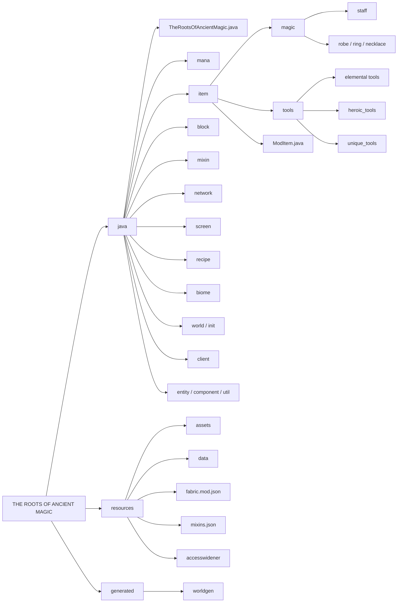

</details>
<br>

<div align="right">
    <a href="#top">⬆ До початку сторінки</a>
</div>

<hr>

<!--  -->
<h1 id="all-modules">Технології проєкту</h1>

<p style="text-align: justify; line-height: 1.8;">
  <a href="https://www.minecraft.net/" style="font-size: 20px;">Minecraft Java Edition 1.20.1</a>
  <span style="font-size: 16px;"> - гра, для якої створено мод.</span>
  <br>
  <a href="https://fabricmc.net/" style="font-size: 20px;">Fabric Loader</a>
  <span style="font-size: 16px;"> - легкий завантажувач модів.</span>
  <br>
  <a href="https://modrinth.com/mod/fabric-api" style="font-size: 20px;">Fabric API</a>
  <span style="font-size: 16px;"> - події, мережа, реєстри та інші інструменти для модів.</span>
  <br>
  <a href="https://adoptium.net/" style="font-size: 20px;">Java 17</a>
  <span style="font-size: 16px;"> - мова програмування мода.</span>
  <br>
  <a href="https://github.com/SpongePowered/Mixin" style="font-size: 20px;">Mixin</a>
  <span style="font-size: 16px;"> - внесення змін у код самої гри.</span>
  <br>
  <a href="https://github.com/FabricMC/yarn" style="font-size: 20px;">Yarn</a>
  <span style="font-size: 16px;"> - читабельні назви класів і методів Minecraft.</span>
  <br>
  <a href="https://github.com/FabricMC/fabric-loom" style="font-size: 20px;">Gradle + Fabric Loom</a>
  <span style="font-size: 16px;"> - збірка мода та запуск у режимі розробки.</span>
  <br>
  <a href="https://docs.fabricmc.net/" style="font-size: 20px;">Fabric Data Generation</a>
  <span style="font-size: 16px;"> - генерація JSON-файлів світу.</span>
</p>

<h1 id="all-modules-eng">Project Technologies</h1>

<details>
  <summary style="font-style: italic; font-size: 14px;">English translation</summary>
  <br>
  <p style="text-align: justify; line-height: 1.8;">
    <a href="https://www.minecraft.net/" style="font-size: 20px;">Minecraft Java Edition 1.20.1</a>
    <span style="font-size: 16px;"> - the game the mod is made for.</span>
    <br>
    <a href="https://fabricmc.net/" style="font-size: 20px;">Fabric Loader</a>
    <span style="font-size: 16px;"> - a lightweight mod loader.</span>
    <br>
    <a href="https://modrinth.com/mod/fabric-api" style="font-size: 20px;">Fabric API</a>
    <span style="font-size: 16px;"> - events, networking, registries and other tools for mods.</span>
    <br>
    <a href="https://adoptium.net/" style="font-size: 20px;">Java 17</a>
    <span style="font-size: 16px;"> - the programming language of the mod.</span>
    <br>
    <a href="https://github.com/SpongePowered/Mixin" style="font-size: 20px;">Mixin</a>
    <span style="font-size: 16px;"> - making changes to the game's own code.</span>
    <br>
    <a href="https://github.com/FabricMC/yarn" style="font-size: 20px;">Yarn</a>
    <span style="font-size: 16px;"> - readable names for Minecraft classes and methods.</span>
    <br>
    <a href="https://github.com/FabricMC/fabric-loom" style="font-size: 20px;">Gradle + Fabric Loom</a>
    <span style="font-size: 16px;"> - building the mod and running it in development mode.</span>
    <br>
    <a href="https://docs.fabricmc.net/" style="font-size: 20px;">Fabric Data Generation</a>
    <span style="font-size: 16px;"> - generating world JSON files.</span>
  </p>
</details>
<br>

<hr>

<div align="right">
    <a href="#top">⬆ До початку сторінки</a>
</div>

<br>

<!--  -->

<!--  -->
<h1 id="install-mod">Встановлення мода</h1>

<p style="text-align: justify; font-size: 18px; line-height: 1.7;">
    Мод можна встановити з готового файлу або зібрати самостійно.
</p>


<h1 id="install-mod-eng">Installing the Mod</h1>

<details>
  <summary style="font-style: italic; font-size: 14px;">English translation</summary>
  <br>
  <p style="text-align: justify; font-size: 18px; line-height: 1.7;">
      The mod can be installed from a ready-made file or built yourself.
  </p>
</details>
<br>

<hr>

<h3 style="font-size: 20px;" id="ready-jar">
    Готовий .jar файл
</h3>

<p style="text-align: justify; font-size: 16px; line-height: 1.7;">
    Готовий файл мода лежить у папці <b>releases</b> репозиторію: <b>releases/the-roots-of-ancient-magic.jar</b>. Для гри потрібні Minecraft Java Edition 1.20.1, Fabric Loader та Fabric API Java 17 вже вбудована в офіційний лаунчер.
</p>


<h3 style="font-size: 20px;" id="ready-jar-eng">
    Ready-made .jar file
</h3>

<details>
  <summary style="font-style: italic; font-size: 14px;">English translation</summary>
  <br>
  <p style="text-align: justify; font-size: 16px; line-height: 1.7;">
      The ready-made mod file is in the <b>releases</b> folder of the repository: <b>releases/the-roots-of-ancient-magic.jar</b>. You need Minecraft Java Edition 1.20.1, Fabric Loader and Fabric API Java 17 is already bundled with the official launcher.
  </p>
</details>
<br>

<hr>

<ol style="font-size: 18px; line-height: 1.8; padding-left: 40px;">
  <li>
      Запустіть Minecraft Java Edition 1.20.1 хоча б один раз.
  </li>
  <li>
      Встановіть Fabric Loader для 1.20.1 з <a href="https://fabricmc.net/use/installer/">fabricmc.net</a>.
  </li>
  <li>
      Завантажте Fabric API для 1.20.1 з <a href="https://modrinth.com/mod/fabric-api">Modrinth</a>.
  </li>
  <li>
      Скопіюйте <b>.jar</b> мода та <b>Fabric API</b> у папку <b>mods</b> (Windows: <b>%appdata%\.minecraft\mods</b>, macOS: <b>~/Library/Application Support/minecraft/mods</b>).
  </li>
  <li>
      У лаунчері оберіть профіль <b>Fabric</b> і натисніть <b>Play</b>.
  </li>
</ol>

<h3 style="font-size: 20px;" id="ready-jar-steps-eng">Installation steps</h3>

<details>
  <summary style="font-style: italic; font-size: 14px;">English translation</summary>
  <br>
  <ol style="font-size: 18px; line-height: 1.8; padding-left: 40px;">
    <li>
        Launch Minecraft Java Edition 1.20.1 at least once.
    </li>
    <li>
        Install Fabric Loader for 1.20.1 from <a href="https://fabricmc.net/use/installer/">fabricmc.net</a>.
    </li>
    <li>
        Download Fabric API for 1.20.1 from <a href="https://modrinth.com/mod/fabric-api">Modrinth</a>.
    </li>
    <li>
        Copy the mod <b>.jar</b> and <b>Fabric API</b> into the <b>mods</b> folder (Windows: <b>%appdata%\.minecraft\mods</b>, macOS: <b>~/Library/Application Support/minecraft/mods</b>).
    </li>
    <li>
        In the launcher, select the <b>Fabric</b> profile and press <b>Play</b>.
    </li>
  </ol>
</details>
<br>

<div align="center">
    
</div>

<hr>

<div align="right">
    <a href="#top">⬆ До початку сторінки</a>
</div>

<br>

<h3 style="font-size: 20px;" id="run-client">
    Запуск у режимі розробки
</h3>

<p style="text-align: justify; font-size: 16px; line-height: 1.7;">
    Якщо хочете самі запустити мод, потрібні <b>JDK 17</b> та <b>Git</b>. Склонуйте репозиторій, відкрийте папку проєкту в IDE та виконайте команду в терміналі: відкриється Minecraft із підключеним модом.
</p>


<h3 style="font-size: 20px;" id="run-client-eng">
    Running in development mode
</h3>

<details>
  <summary style="font-style: italic; font-size: 14px;">English translation</summary>
  <br>
  <p style="text-align: justify; font-size: 16px; line-height: 1.7;">
      If you want to run the mod yourself, you need <b>JDK 17</b> and <b>Git</b>. Clone the repository, open the project folder in an IDE and run the command in the terminal: Minecraft will start with the mod loaded.
  </p>
</details>
<br>

```bash
git clone <HTTPS-посилання>
cd <папка-проєкту>

./gradlew runClient
```

<div align="center">
    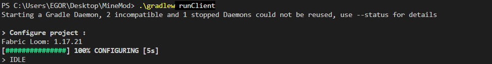
</div>

<hr>

<h3 style="font-size: 20px;" id="build-jar">
    Збірка .jar самостійно
</h3>

<p style="text-align: justify; font-size: 16px; line-height: 1.7;">
    Щоб зібрати власний файл мода, виконайте команду нижче. Готовий <b>.jar</b> з'явиться в папці <b>build/libs</b> (потрібен файл без <b>-sources</b> у назві).
</p>


<h3 style="font-size: 20px;" id="build-jar-eng">
    Building the .jar yourself
</h3>

<details>
  <summary style="font-style: italic; font-size: 14px;">English translation</summary>
  <br>
  <p style="text-align: justify; font-size: 16px; line-height: 1.7;">
      To build your own mod file, run the command below. The finished <b>.jar</b> will appear in <b>build/libs</b> (use the file without <b>-sources</b> in its name).
  </p>
</details>
<br>

```bash
./gradlew build
```

<div align="center">
    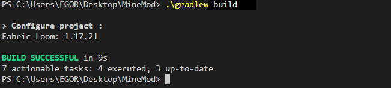
</div>

<hr>

<div align="right">
    <a href="#top">⬆ До початку сторінки</a>
</div>

<br>

<!--  -->

<h1 id="base-mechanics">Опис мода</h1>

<p style="text-align: justify; font-size: 18px; line-height: 1.7;">
    Мод додає в Minecraft магію шести стихій: вогню, води, повітря, землі, темряви та світла.
</p>

<p style="text-align: justify; font-size: 18px; line-height: 1.7;">
    Заклинання витрачають ману. Шкала мани відображається праворуч на екрані та поступово відновлюється.
</p>

<p style="text-align: justify; font-size: 18px; line-height: 1.7;">
    У нових біомах ростуть квіти стихій. У Пічному порошку з них роблять есенції, які потрібні для стихійного спорядження.
</p>

<p style="text-align: justify; font-size: 18px; line-height: 1.7;">
    Спорядження дає здібності: посохи кастують заклинання, мантії та кільця активуються клавішами, намиста працюють пасивно, повний комплект броні дає бонус, а унікальна зброя має власні вміння.
</p>

<p style="text-align: justify; font-size: 18px; line-height: 1.7;">
    Для мантії, намиста та двох кілець в інвентарі є окремі слоти.
</p>

<h1 id="base-mechanics-eng">Mod Description</h1>

<details>
  <summary style="font-style: italic; font-size: 14px;">English translation</summary>
  <br>
  <p style="text-align: justify; font-size: 18px; line-height: 1.7;">
      The mod adds the magic of six elements to Minecraft: fire, water, air, earth, darkness and light.
  </p>
  <p style="text-align: justify; font-size: 18px; line-height: 1.7;">
      Spells cost mana. The mana bar is shown on the right side of the screen and slowly regenerates.
  </p>
  <p style="text-align: justify; font-size: 18px; line-height: 1.7;">
      Elemental flowers grow in the new biomes. In the Furnace Powder they are turned into essences, which are needed for elemental gear.
  </p>
  <p style="text-align: justify; font-size: 18px; line-height: 1.7;">
      Gear grants abilities: staffs cast spells, robes and rings are activated with keys, necklaces work passively, a full armor set gives a bonus, and unique weapons have their own skills.
  </p>
  <p style="text-align: justify; font-size: 18px; line-height: 1.7;">
      The inventory has separate slots for a robe, a necklace and two rings.
  </p>
</details>
<br>

<hr>

<h3 style="font-size: 20px;" id="entrypoint">
    <a href="src/main/java/com/therootsofancientmagic/TheRootsOfAncientMagic.java">Головний клас мода</a>
</h3>

<p style="text-align: justify; font-size: 16px; line-height: 1.7;">
    Точка входу мода. Тут реєструються предмети, блоки, рецепти та екрани, а кожного тіка сервер застосовує ефекти аксесуарів і відновлює ману всім гравцям.
</p>


<h3 style="font-size: 20px;" id="entrypoint-eng">
    <a href="src/main/java/com/therootsofancientmagic/TheRootsOfAncientMagic.java">Main mod class</a>
</h3>

<details>
  <summary style="font-style: italic; font-size: 14px;">English translation</summary>
  <br>
  <p style="text-align: justify; font-size: 16px; line-height: 1.7;">
      The mod entry point. Items, blocks, recipes and screens are registered here, and on every tick the server applies accessory effects and regenerates mana for all players.
  </p>
</details>
<br>

```java
ModItem.registerModItems();
ModBlock.registerModBlocks();
ModRecipes.registerRecipes();
ModScreenHandlers.registerScreenHandlers();
RobeAbilityServerHandler.register();

ServerTickEvents.START_SERVER_TICK.register(server -> {
    for (ServerPlayerEntity player : server.getPlayerManager().getPlayerList()) {
        AccessoryHandler.applyAccessoryEffects(player);
        PlayerMana.regenerateMana(player);
    }
});
```

<hr>

<h3 style="font-size: 20px;" id="client-entry">
    <a href="src/main/java/com/therootsofancientmagic/client/TheRootsOfAncientMagicClient.java">Клієнтська частина</a>
</h3>

<p style="text-align: justify; font-size: 16px; line-height: 1.7;">
    Реєструє клавіші (<b>R</b> мантія, <b>Z</b> і <b>V</b> кільця), шкалу мани та ефекти біомів. Натискання клавіші надсилає пакет на сервер.
</p>


<h3 style="font-size: 20px;" id="client-entry-eng">
    <a href="src/main/java/com/therootsofancientmagic/client/TheRootsOfAncientMagicClient.java">Client side</a>
</h3>

<details>
  <summary style="font-style: italic; font-size: 14px;">English translation</summary>
  <br>
  <p style="text-align: justify; font-size: 16px; line-height: 1.7;">
      Registers the keys (<b>R</b> - robe, <b>Z</b> and <b>V</b> - rings), the mana bar and biome effects. Pressing a key sends a packet to the server.
  </p>
</details>
<br>

```java
robeAbilityKey = KeyBindingHelper.registerKeyBinding(new KeyBinding(
        "key.therootsofancientmagic.robe_ability",
        InputUtil.Type.KEYSYM,
        GLFW.GLFW_KEY_R,
        "category.therootsofancientmagic.general"
));

while (robeAbilityKey.wasPressed()) {
    ClientPlayNetworking.send(ROBE_ABILITY_PACKET, PacketByteBufs.create());
}
```

<hr>

<h3 style="font-size: 20px;" id="mixins">
    <a href="src/main/resources/the-roots-of-ancient-magic.mixins.json">Міксини</a>
</h3>

<p style="text-align: justify; font-size: 16px; line-height: 1.7;">
    Mixin дозволяє змінити код самої гри без її редагування. У моді міксини додають слоти, ману, бонуси броні та ефекти біомів.
</p>


<h3 style="font-size: 20px;" id="mixins-eng">
    <a href="src/main/resources/the-roots-of-ancient-magic.mixins.json">Mixins</a>
</h3>

<details>
  <summary style="font-style: italic; font-size: 14px;">English translation</summary>
  <br>
  <p style="text-align: justify; font-size: 16px; line-height: 1.7;">
      Mixin lets you change the game's own code without editing it. In this mod mixins add slots, mana, armor bonuses and biome effects.
  </p>
</details>
<br>

```json
"entrypoints": {
    "main": ["com.therootsofancientmagic.TheRootsOfAncientMagic"],
    "client": ["com.therootsofancientmagic.client.TheRootsOfAncientMagicClient"],
    "fabric-datagen": ["com.therootsofancientmagic.TheRootsOfAncientMagicDataGenerator"]
},
"depends": {
    "fabricloader": ">=0.19.3",
    "minecraft": "~1.20.1",
    "java": ">=17",
    "fabric-api": "*"
}
```

<hr>

<h3>Як це працює разом</h3>

<ul style="font-size: 16px; line-height: 1.7;">
    <li>ModEntityDataSaverMixin -> зберігання мани в NBT гравця</li>
    <li>PlayerEntityMixin -> слоти аксесуарів, здібності кілець, мантій і намист</li>
    <li>PlayerScreenHandlerMixin, InventoryScreenMixin -> слоти аксесуарів в інвентарі</li>
    <li>PlayerTickMixin -> бонуси повного комплекту броні</li>
    <li>HungerManagerMixin -> намисто не дає голодувати</li>
    <li>InGameHudMixin, BackgroundRendererMixin -> клієнтська частина (HUD, туман біома Earth)</li>
</ul>

<h3>How It Works Together</h3>

<details>
  <summary style="font-style: italic; font-size: 14px;">English translation</summary>
  <br>
  <ul style="font-size: 16px; line-height: 1.7;">
      <li>ModEntityDataSaverMixin -> stores mana in the player's NBT</li>
      <li>PlayerEntityMixin -> accessory slots, ring, robe and necklace abilities</li>
      <li>PlayerScreenHandlerMixin, InventoryScreenMixin -> accessory slots in the inventory</li>
      <li>PlayerTickMixin -> full armor set bonuses</li>
      <li>HungerManagerMixin -> a necklace prevents hunger</li>
      <li>InGameHudMixin, BackgroundRendererMixin -> client side (HUD, Earth biome fog)</li>
  </ul>
</details>
<br>

<div align="right">
    <a href="#top">⬆ До початку сторінки</a>
</div>

<br>

<!--  -->

<!--  -->
<h1 id="mana-system">Система мани</h1>

<p style="text-align: justify; font-size: 18px; line-height: 1.7;">
    Мана основа всієї магії мода. Це число від 0 до 100: кожне заклинання знімає частину мани, а кожну секунду повертається 10 одиниць.
</p>


<h1 id="mana-system-eng">Mana System</h1>

<details>
  <summary style="font-style: italic; font-size: 14px;">English translation</summary>
  <br>
  <p style="text-align: justify; font-size: 18px; line-height: 1.7;">
      Mana is the basis of all the magic in the mod. It is a number from 0 to 100: every spell takes some mana, and 10 points are restored every second.
  </p>
</details>
<br>

<hr>

<h3 style="font-size: 20px;" id="mana-core">
    <a href="src/main/java/com/therootsofancientmagic/mana/PlayerMana.java">Витрата та відновлення</a>
</h3>

<p style="text-align: justify; font-size: 16px; line-height: 1.7;">
    Якщо мани не вистачає, заклинання не спрацьовує.
</p>


<h3 style="font-size: 20px;" id="mana-core-eng">
    <a href="src/main/java/com/therootsofancientmagic/mana/PlayerMana.java">Spending and regeneration</a>
</h3>

<details>
  <summary style="font-style: italic; font-size: 14px;">English translation</summary>
  <br>
  <p style="text-align: justify; font-size: 16px; line-height: 1.7;">
      If there is not enough mana, the spell does not work.
  </p>
</details>
<br>

```java
if (currentMana >= amount) {
    int finalMana = currentMana - amount;
    nbt.putInt("mana", finalMana);
    ModMessages.sendToClient(serverPlayer, finalMana);
    return true;
}
return false;
```

<hr>

<h3 style="font-size: 20px;" id="mana-save">
    <a href="src/main/java/com/therootsofancientmagic/mixin/ModEntityDataSaverMixin.java">Збереження мани</a>
</h3>

<p style="text-align: justify; font-size: 16px; line-height: 1.7;">
    Через Mixin у клас Entity додається власний NBT-блок. Мана записується разом з гравцем, тому не втрачається після виходу зі світу.
</p>


<h3 style="font-size: 20px;" id="mana-save-eng">
    <a href="src/main/java/com/therootsofancientmagic/mixin/ModEntityDataSaverMixin.java">Saving mana</a>
</h3>

<details>
  <summary style="font-style: italic; font-size: 14px;">English translation</summary>
  <br>
  <p style="text-align: justify; font-size: 16px; line-height: 1.7;">
      A custom NBT block is added to the Entity class via Mixin. Mana is saved together with the player, so it is not lost after leaving the world.
  </p>
</details>
<br>

```java
@Inject(method = "writeNbt", at = @At("HEAD"))
protected void injectWriteMethod(NbtCompound nbt, CallbackInfoReturnable<NbtCompound> info) {
    if (this.persistentData != null) {
        nbt.put("therootsofancientmagic.mana_data", this.persistentData);
    }
}
```

<hr>

<h3 style="font-size: 20px;" id="mana-hud">
    <a href="src/main/java/com/therootsofancientmagic/client/ManaHudOverlay.java">Шкала мани на екрані</a>
</h3>

<p style="text-align: justify; font-size: 16px; line-height: 1.7;">
    Сервер надсилає значення мани пакетом, а клієнт малює 10 куль (по 10 одиниць кожна). У творчому режимі шкала прихована.
</p>


<h3 style="font-size: 20px;" id="mana-hud-eng">
    <a href="src/main/java/com/therootsofancientmagic/client/ManaHudOverlay.java">Mana bar on screen</a>
</h3>

<details>
  <summary style="font-style: italic; font-size: 14px;">English translation</summary>
  <br>
  <p style="text-align: justify; font-size: 16px; line-height: 1.7;">
      The server sends the mana value in a packet, and the client draws 10 orbs (10 points each). The bar is hidden in creative mode.
  </p>
</details>
<br>

```java
PacketByteBuf buf = PacketByteBufs.create();
buf.writeInt(mana);
ServerPlayNetworking.send(player, MANA_SYNC_ID, buf);
```

```java
if (currentMana > threshold) {
    drawContext.drawTexture(MANA_TEXTURE, xStart, yPos, 0, 0, 16, 16, 32, 16);
} else {
    drawContext.drawTexture(MANA_TEXTURE, xStart, yPos, 16, 0, 16, 16, 32, 16);
}
```

<div align="center">
    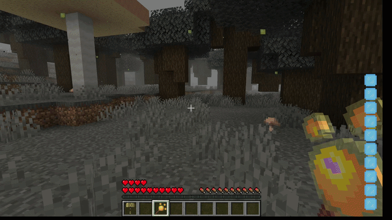
</div>

<hr>

<div align="right">
    <a href="#top">⬆ До початку сторінки</a>
</div>

<br>

<!--  -->

<!--  -->
<h1 id="resources">Ресурси та крафт</h1>

<p style="text-align: justify; font-size: 18px; line-height: 1.7;">
    Квіти стихій ростуть у своїх біомах. У Пічному порошку з квітки виходить есенція, а спорядження створюється у спеціальному столі крафту.
</p>


<h1 id="resources-eng">Resources and Crafting</h1>

<details>
  <summary style="font-style: italic; font-size: 14px;">English translation</summary>
  <br>
  <p style="text-align: justify; font-size: 18px; line-height: 1.7;">
      Elemental flowers grow in their own biomes. In the Furnace Powder a flower turns into an essence, and gear is crafted at a special craft table.
  </p>
</details>
<br>

<hr>

<h3 style="font-size: 20px;" id="furnace-powder">
    <a href="src/main/java/com/therootsofancientmagic/block/entity/FurnacePowderBlockEntity.java">Пічний порошок</a>
</h3>

<p style="text-align: justify; font-size: 16px; line-height: 1.7;">
    Блок із власним меню (вхід і вихід). Кладемо квітку приблизно через 3,6 с отримуємо відповідну есенцію.
</p>


<h3 style="font-size: 20px;" id="furnace-powder-eng">
    <a href="src/main/java/com/therootsofancientmagic/block/entity/FurnacePowderBlockEntity.java">Furnace Powder</a>
</h3>

<details>
  <summary style="font-style: italic; font-size: 14px;">English translation</summary>
  <br>
  <p style="text-align: justify; font-size: 16px; line-height: 1.7;">
      A block with its own menu input and output. Put a flower in and after about 3.6 s you get the matching essence.
  </p>
</details>
<br>

```java
if (input == ModFlowerBlock.FLOWER_FIRE.asItem()) {
    return new ItemStack(ModItem.ESSENCE_FIRE);
} else if (input == ModFlowerBlock.FLOWER_AQUA.asItem()) {
    return new ItemStack(ModItem.ESSENCE_AQUA);
}
// ... так само для повітря, землі, темряви та світла
```

<div align="center">
    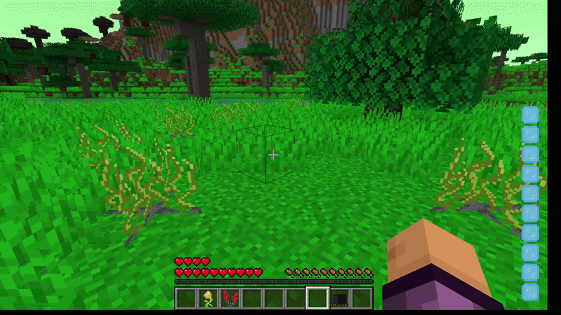
</div>

<hr>

<h3 style="font-size: 20px;" id="craft-table">
    <a href="src/main/java/com/therootsofancientmagic/recipe/CraftTableRecipe.java">Стіл крафту</a>
</h3>

<p style="text-align: justify; font-size: 16px; line-height: 1.7;">
    Окремий стіл 3×3 зі своїм типом рецептів. Рецепти звичайні shaped, але працюють лише в цьому столі.
</p>


<h3 style="font-size: 20px;" id="craft-table-eng">
    <a href="src/main/java/com/therootsofancientmagic/recipe/CraftTableRecipe.java">Craft Table</a>
</h3>

<details>
  <summary style="font-style: italic; font-size: 14px;">English translation</summary>
  <br>
  <p style="text-align: justify; font-size: 16px; line-height: 1.7;">
      A separate 3×3 table with its own recipe type. Recipes are regular shaped ones, but they work only at this table.
  </p>
</details>
<br>

```java
ShapedRecipe shaped = RecipeSerializer.SHAPED.read(id, json);
return new CraftTableRecipe(shaped);
```

```java
Optional<CraftingRecipe> optional = world.getRecipeManager()
        .getFirstMatch(ModRecipes.CUSTOM_CRAFTING_TYPE, inventory, world);
```

<div align="center">
    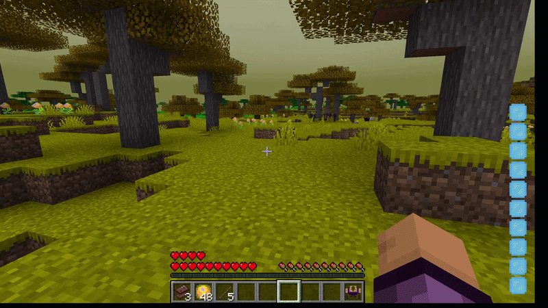
</div>

<hr>

<div align="right">
    <a href="#top">⬆ До початку сторінки</a>
</div>

<br>

<!--  -->

<!--  -->
<h1 id="staffs">Посохи</h1>

<p style="text-align: justify; font-size: 18px; line-height: 1.7;">
    Посох використовується правою кнопкою миші. Кожне заклинання коштує ману та йде на перезарядку.
</p>


<h1 id="staffs-eng">Staffs</h1>

<details>
  <summary style="font-style: italic; font-size: 14px;">English translation</summary>
  <br>
  <p style="text-align: justify; font-size: 18px; line-height: 1.7;">
      A staff is used with the right mouse button. Every spell costs mana and goes on cooldown.
  </p>
</details>
<br>

<hr>

<h3 style="font-size: 20px;" id="staff-logic">
    <a href="src/main/java/com/therootsofancientmagic/item/magic/staff/FireStaff.java">Як працює посох</a>
</h3>

<p style="text-align: justify; font-size: 16px; line-height: 1.7;">
    Усі посохи працюють однаково: перевірка перезарядки -> списання мани -> заклинання -> перезарядка. Нижче показано це на прикладі вогняного посоха.
</p>


<h3 style="font-size: 20px;" id="staff-logic-eng">
    <a href="src/main/java/com/therootsofancientmagic/item/magic/staff/FireStaff.java">How a staff works</a>
</h3>

<details>
  <summary style="font-style: italic; font-size: 14px;">English translation</summary>
  <br>
  <p style="text-align: justify; font-size: 16px; line-height: 1.7;">
      All staffs work the same way: cooldown check -> mana cost -> spell -> cooldown. Below is an example with the Fire Staff.
  </p>
</details>
<br>

```java
if (user.getItemCooldownManager().isCoolingDown(this)) {
    return TypedActionResult.fail(stack);
}

if (!world.isClient && user instanceof ServerPlayerEntity serverPlayer) {
    if (!PlayerMana.consumeMana((IEntityDataSaver) serverPlayer, 40, serverPlayer)) {
        return TypedActionResult.fail(stack);
    }

    castSpell(world, user);
    user.getItemCooldownManager().set(this, COOLDOWN_TICKS);
}
```

<hr>

<h3 style="font-size: 20px;" id="staff-list">
    Усі посохи
</h3>

<table style="font-size: 16px; line-height: 1.6;">
  <thead>
    <tr><th>Посох</th><th>Мана</th><th>Перезарядка</th><th>Що робить</th></tr>
  </thead>
  <tbody>
    <tr><td>Вогняний</td><td>40</td><td>45 с</td><td>Вогняна куля з вибухом.</td></tr>
    <tr><td>Повітря</td><td>40</td><td>45 с</td><td>Підкидає та притягує істот у точці, на яку дивиться гравець.</td></tr>
    <tr><td>Земляний</td><td>40</td><td>45 с</td><td>Кам'яна сфера, відкидання істот, хмара сповільнення та слабкості.</td></tr>
    <tr><td>Водяний</td><td>50</td><td>45 с</td><td>Крижана сфера, відкидання істот, хмара сповільнення та висушування.</td></tr>
    <tr><td>Темний</td><td>60</td><td>60 с</td><td>Хвиля відкидання, невидимість і швидкість на 20 с, хмара висушування.</td></tr>
    <tr><td>Світлий</td><td>6</td><td>60 с</td><td>Телепорт до 50 блоків, хмари світіння на старті та фініші.</td></tr>
    <tr><td>Героїчний</td><td>100</td><td>60 с</td><td>Обсидіановий купол зі снігом навколо кожної істоти в радіусі 10 блоків.</td></tr>
  </tbody>
</table>

<h3 style="font-size: 20px;" id="staff-list-eng">
    All staffs
</h3>

<details>
  <summary style="font-style: italic; font-size: 14px;">English translation</summary>
  <br>
  <table style="font-size: 16px; line-height: 1.6;">
    <thead>
      <tr><th>Staff</th><th>Mana</th><th>Cooldown</th><th>What it does</th></tr>
    </thead>
    <tbody>
      <tr><td>Fire</td><td>40</td><td>45 s</td><td>A fireball with an explosion.</td></tr>
      <tr><td>Air</td><td>40</td><td>45 s</td><td>Lifts and pulls entities at the point the player looks at.</td></tr>
      <tr><td>Earth</td><td>40</td><td>45 s</td><td>A stone sphere, knockback, a cloud of slowness and weakness.</td></tr>
      <tr><td>Aqua</td><td>50</td><td>45 s</td><td>An ice sphere, knockback, a cloud of slowness and withering.</td></tr>
      <tr><td>Dark</td><td>60</td><td>60 s</td><td>A knockback wave, invisibility and speed for 20 s, a withering cloud.</td></tr>
      <tr><td>Light</td><td>6</td><td>60 s</td><td>Teleport up to 50 blocks, glowing clouds at the start and the finish.</td></tr>
      <tr><td>Heroic</td><td>100</td><td>60 s</td><td>An obsidian dome with snow around every entity within 10 blocks.</td></tr>
    </tbody>
  </table>
</details>
<br>

<hr>

<h3 style="font-size: 20px;" id="fire-staff">
    <a href="src/main/java/com/therootsofancientmagic/item/magic/staff/FireStaff.java">Вогняний посох</a>
</h3>


<h3 style="font-size: 20px;" id="fire-staff-eng">
    <a href="src/main/java/com/therootsofancientmagic/item/magic/staff/FireStaff.java">Fire Staff</a>
</h3>

<br>

```java
FireballEntity fireball = new FireballEntity(world, user,
        lookVec.x * 0.3, lookVec.y * 0.3, lookVec.z * 0.3, 3);
world.spawnEntity(fireball);
```

<div align="center">
    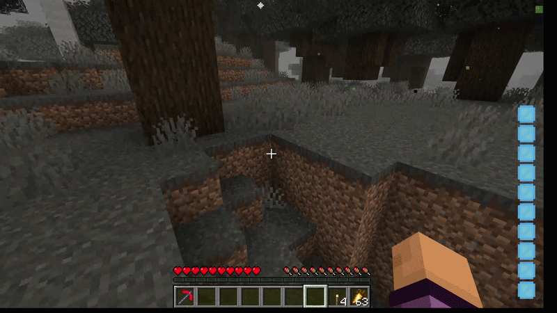
</div>

<hr>

<h3 style="font-size: 20px;" id="air-staff">
    <a href="src/main/java/com/therootsofancientmagic/item/magic/staff/AirStaff.java">Посох повітря</a>
</h3>


<h3 style="font-size: 20px;" id="air-staff-eng">
    <a href="src/main/java/com/therootsofancientmagic/item/magic/staff/AirStaff.java">Air Staff</a>
</h3>

<br>

```java
Vec3d toCenter = targetPoint.subtract(entity.getPos());
Vec3d pullVec = toCenter.normalize().multiply(PULL_STRENGTH);

Vec3d newVelocity = entity.getVelocity()
        .add(pullVec.x, pullVec.y, pullVec.z)
        .add(0, LAUNCH_VELOCITY_Y, 0);

entity.setVelocity(newVelocity);
entity.velocityModified = true;
```

<div align="center">
    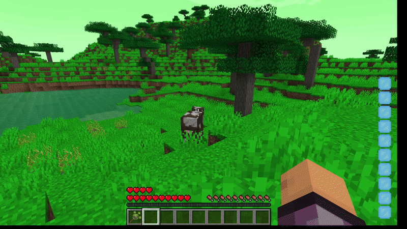
</div>

<hr>

<h3 style="font-size: 20px;" id="earth-staff">
    <a href="src/main/java/com/therootsofancientmagic/item/magic/staff/EarthStaff.java">Земляний посох</a>
</h3>

<p style="text-align: justify; font-size: 16px; line-height: 1.7;">
    Сфера будується з блоків на відстані радіуса від центру. Водяний посох робить те саме, але з льоду.
</p>


<h3 style="font-size: 20px;" id="earth-staff-eng">
    <a href="src/main/java/com/therootsofancientmagic/item/magic/staff/EarthStaff.java">Earth Staff</a>
</h3>

<details>
  <summary style="font-style: italic; font-size: 14px;">English translation</summary>
  <br>
  <p style="text-align: justify; font-size: 16px; line-height: 1.7;">
      The sphere is built from blocks at a radius distance from the center. The Aqua Staff does the same, but with ice.
  </p>
</details>
<br>

```java
double distance = Math.sqrt(x * x + y * y + z * z);
if (distance < SPHERE_RADIUS - 0.5D || distance > SPHERE_RADIUS + 0.5D) {
    continue;
}

if (world.getBlockState(blockPos).isReplaceable()) {
    world.setBlockState(blockPos, Blocks.STONE.getDefaultState());
}
```

<div align="center">
    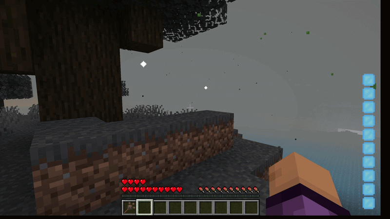
</div>

<hr>

<h3 style="font-size: 20px;" id="aqua-staff">
    <a href="src/main/java/com/therootsofancientmagic/item/magic/staff/AquaStaff.java">Водяний посох</a>
</h3>


<h3 style="font-size: 20px;" id="aqua-staff-eng">
    <a href="src/main/java/com/therootsofancientmagic/item/magic/staff/AquaStaff.java">Aqua Staff</a>
</h3>

<br>

<div align="center">
    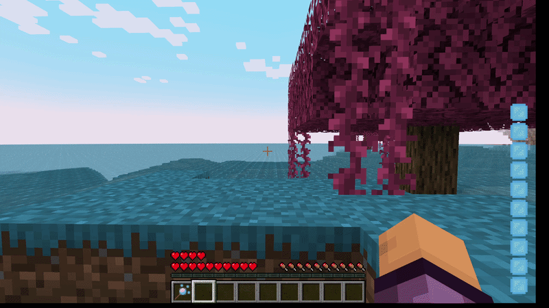
</div>

<hr>

<h3 style="font-size: 20px;" id="dark-staff">
    <a href="src/main/java/com/therootsofancientmagic/item/magic/staff/DarkStaff.java">Темний посох</a>
</h3>


<h3 style="font-size: 20px;" id="dark-staff-eng">
    <a href="src/main/java/com/therootsofancientmagic/item/magic/staff/DarkStaff.java">Dark Staff</a>
</h3>

<br>

```java
AreaEffectCloudEntity cloud = new AreaEffectCloudEntity(world, user.getX(), user.getY(), user.getZ());
cloud.setParticleType(ParticleTypes.DRAGON_BREATH);
cloud.setRadius((float) WAVE_RADIUS);
cloud.addEffect(new StatusEffectInstance(StatusEffects.WITHER, 100, 1));
world.spawnEntity(cloud);
```

<div align="center">
    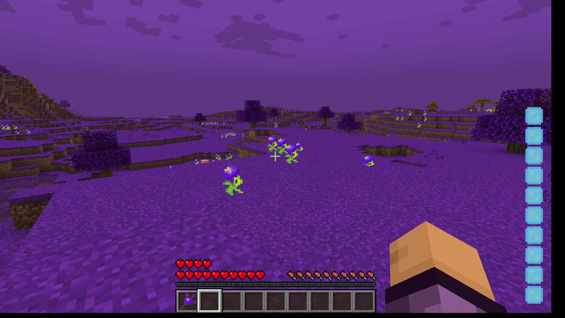
</div>

<hr>

<h3 style="font-size: 20px;" id="light-staff">
    <a href="src/main/java/com/therootsofancientmagic/item/magic/staff/LightStaff.java">Світлий посох</a>
</h3>

<p style="text-align: justify; font-size: 16px; line-height: 1.7;">
    Гравець телепортується туди, куди дивиться, або одразу перед блоком, що заважає.
</p>


<h3 style="font-size: 20px;" id="light-staff-eng">
    <a href="src/main/java/com/therootsofancientmagic/item/magic/staff/LightStaff.java">Light Staff</a>
</h3>

<details>
  <summary style="font-style: italic; font-size: 14px;">English translation</summary>
  <br>
  <p style="text-align: justify; font-size: 16px; line-height: 1.7;">
      The player teleports where they are looking, or right in front of a block in the way.
  </p>
</details>
<br>

```java
HitResult hit = world.raycast(new RaycastContext(start, end,
        RaycastContext.ShapeType.COLLIDER, RaycastContext.FluidHandling.NONE, serverPlayer));

if (hit.getType() == HitResult.Type.BLOCK) {
    teleportPos = hit.getPos().subtract(direction.x, direction.y, direction.z);
} else {
    teleportPos = end;
}

serverPlayer.teleport(serverWorld, teleportPos.x, teleportPos.y, teleportPos.z,
        serverPlayer.getYaw(), serverPlayer.getPitch());
```

<div align="center">
    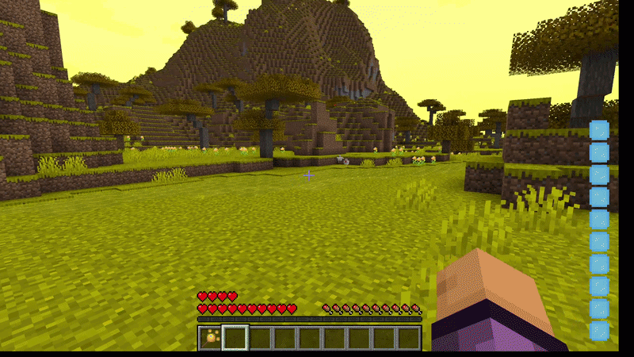
</div>

<hr>

<h3 style="font-size: 20px;" id="heroic-staff">
    <a href="src/main/java/com/therootsofancientmagic/item/tools/heroic_tools/HeroicStaff.java">Героїчний посох</a>
</h3>

<p style="text-align: justify; font-size: 16px; line-height: 1.7;">
    Працює лише коли поруч є хоча б одна істота; тоді купол з'являється навколо кожної з них.
</p>


<h3 style="font-size: 20px;" id="heroic-staff-eng">
    <a href="src/main/java/com/therootsofancientmagic/item/tools/heroic_tools/HeroicStaff.java">Heroic Staff</a>
</h3>

<details>
  <summary style="font-style: italic; font-size: 14px;">English translation</summary>
  <br>
  <p style="text-align: justify; font-size: 16px; line-height: 1.7;">
      Works only when at least one entity is nearby; then a dome appears around each of them.
  </p>
</details>
<br>

<div align="center">
    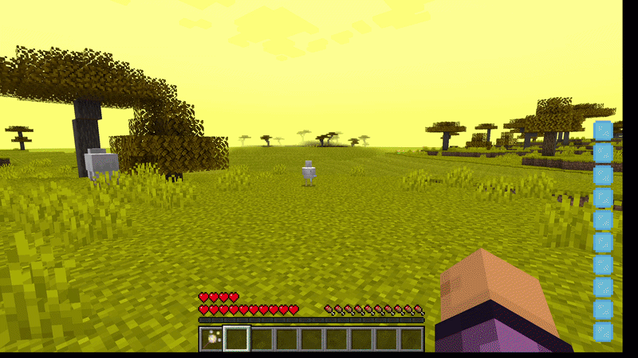
</div>

<hr>

<div align="right">
    <a href="#top">⬆ До початку сторінки</a>
</div>

<br>

<!--  -->

<!--  -->
<h1 id="accessories">Аксесуари</h1>

<p style="text-align: justify; font-size: 18px; line-height: 1.7;">
    Аксесуари це 4 додаткові слоти ліворуч від інвентаря: мантія, намисто та два кільця. Є аксесуари вогню, води, повітря та землі.
</p>


<h1 id="accessories-eng">Accessories</h1>

<details>
  <summary style="font-style: italic; font-size: 14px;">English translation</summary>
  <br>
  <p style="text-align: justify; font-size: 18px; line-height: 1.7;">
      Accessories are 4 extra slots to the left of the inventory: a robe, a necklace and two rings. There are fire, water, air and earth accessories.
  </p>
</details>
<br>

<hr>

<h3 style="font-size: 20px;" id="accessory-slots">
    <a href="src/main/java/com/therootsofancientmagic/screen/CustomArmorSlot.java">Додаткові слоти</a>
</h3>

<p style="text-align: justify; font-size: 16px; line-height: 1.7;">
    Інвентар аксесуарів додається гравцю через Mixin і зберігається разом з ним. Кожен слот приймає лише свій тип предмета.
</p>


<h3 style="font-size: 20px;" id="accessory-slots-eng">
    <a href="src/main/java/com/therootsofancientmagic/screen/CustomArmorSlot.java">Extra slots</a>
</h3>

<details>
  <summary style="font-style: italic; font-size: 14px;">English translation</summary>
  <br>
  <p style="text-align: justify; font-size: 16px; line-height: 1.7;">
      The accessory inventory is added to the player via Mixin and saved together with the player. Each slot accepts only its own type of item.
  </p>
</details>
<br>

```java
@Unique
private final SimpleInventory customArmorInventory = new SimpleInventory(4);
```

```java
public boolean canInsert(ItemStack stack) {
    int index = this.getIndex();

    if (index == 0) return stack.getItem() instanceof ElementalRobeItem;
    if (index == 1) return stack.getItem() instanceof NecklaceItem;
    if (index == 2 || index == 3) return stack.getItem() instanceof RingItem;

    return false;
}
```

<hr>

<h3 style="font-size: 20px;" id="robes">
    <a href="src/main/java/com/therootsofancientmagic/network/RobeAbilityServerHandler.java">Мантії</a>
</h3>

<p style="text-align: justify; font-size: 16px; line-height: 1.7;">
    Клавіша <b>R</b> вмикає здібність мантії: клієнт надсилає пакет, сервер перевіряє перезарядку, знімає 50 мани та накладає ефекти.
</p>

<table style="font-size: 16px; line-height: 1.6;">
  <thead>
    <tr><th>Мантія</th><th>Ефекти</th></tr>
  </thead>
  <tbody>
    <tr><td>Водяна</td><td>Грація дельфіна та Водне дихання, 30 с</td></tr>
    <tr><td>Повітря</td><td>Левітація 2 с та Повільне падіння 7 с</td></tr>
    <tr><td>Земляна</td><td>Стрибучість II та Поспіх II, 30 с</td></tr>
    <tr><td>Вогняна</td><td>Вогнестійкість та Сила II, 30 с; нападники спалахують</td></tr>
  </tbody>
</table>

<h3 style="font-size: 20px;" id="robes-eng">
    <a href="src/main/java/com/therootsofancientmagic/network/RobeAbilityServerHandler.java">Robes</a>
</h3>

<details>
  <summary style="font-style: italic; font-size: 14px;">English translation</summary>
  <br>
  <p style="text-align: justify; font-size: 16px; line-height: 1.7;">
      The <b>R</b> key activates the robe ability: the client sends a packet, the server checks the cooldown, takes 50 mana and applies the effects.
  </p>
  <table style="font-size: 16px; line-height: 1.6;">
    <thead>
      <tr><th>Robe</th><th>Effects</th></tr>
    </thead>
    <tbody>
      <tr><td>Aqua</td><td>Dolphin's Grace and Water Breathing, 30 s</td></tr>
      <tr><td>Air</td><td>Levitation 2 s and Slow Falling 7 s</td></tr>
      <tr><td>Earth</td><td>Jump Boost II and Haste II, 30 s</td></tr>
      <tr><td>Fire</td><td>Fire Resistance and Strength II, 30 s; attackers catch fire</td></tr>
    </tbody>
  </table>
</details>
<br>

```java
if (player.getItemCooldownManager().isCoolingDown(robeItem)) return;

if (!player.isCreative() && !PlayerMana.consumeMana((IEntityDataSaver) player, 50, player)) {
    return;
}

if (backStack.isOf(ModItem.AQUA_ROBE)) {
    player.addStatusEffect(new StatusEffectInstance(StatusEffects.DOLPHINS_GRACE, 600, 0, true, false, false));
    player.addStatusEffect(new StatusEffectInstance(StatusEffects.WATER_BREATHING, 600, 0, true, false, false));
    player.getItemCooldownManager().set(robeItem, 700);
}
```

<div align="center">
    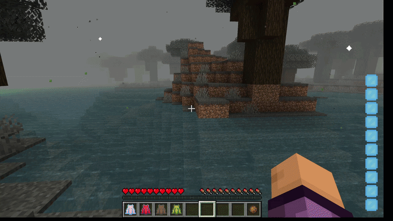
</div>

<hr>

<h3 style="font-size: 20px;" id="rings">
    <a href="src/main/java/com/therootsofancientmagic/util/AccessoryHandler.java">Кільця</a>
</h3>

<p style="text-align: justify; font-size: 16px; line-height: 1.7;">
    Клавіші <b>Z</b> і <b>V</b> по одній на кожне кільце: 30 мани, перезарядка 5 с. Пасивно кожне кільце додає +4 до максимального здоров'я (2 серця).
</p>

<table style="font-size: 16px; line-height: 1.6;">
  <thead>
    <tr><th>Кільце</th><th>Здібність</th></tr>
  </thead>
  <tbody>
    <tr><td>Вогняне</td><td>Ставить вогонь на блок, на який дивиться гравець</td></tr>
    <tr><td>Водяне</td><td>Ставить воду на блок, на який дивиться гравець</td></tr>
    <tr><td>Земляне</td><td>Створює земляний блок 2×2×2</td></tr>
    <tr><td>Повітря</td><td>Ривок уперед у напрямку погляду</td></tr>
  </tbody>
</table>

<h3 style="font-size: 20px;" id="rings-eng">
    <a href="src/main/java/com/therootsofancientmagic/util/AccessoryHandler.java">Rings</a>
</h3>

<details>
  <summary style="font-style: italic; font-size: 14px;">English translation</summary>
  <br>
  <p style="text-align: justify; font-size: 16px; line-height: 1.7;">
      The <b>Z</b> and <b>V</b> keys - one for each ring: 30 mana, 5 s cooldown. Passively, each ring adds +4 to maximum health (2 hearts).
  </p>
  <table style="font-size: 16px; line-height: 1.6;">
    <thead>
      <tr><th>Ring</th><th>Ability</th></tr>
    </thead>
    <tbody>
      <tr><td>Fire</td><td>Places fire on the block the player looks at</td></tr>
      <tr><td>Aqua</td><td>Places water on the block the player looks at</td></tr>
      <tr><td>Earth</td><td>Creates a 2×2×2 block of dirt</td></tr>
      <tr><td>Air</td><td>A dash forward in the direction of view</td></tr>
    </tbody>
  </table>
</details>
<br>

```java
if (hasRing1 && !containsModifier1) {
    maxHealth.addTemporaryModifier(new EntityAttributeModifier(
            RingItem.RING_1_MODIFIER_ID, "Ring Health 1", 4.0, EntityAttributeModifier.Operation.ADDITION));
}
```

```java
Vec3d look = player.getRotationVector();
player.setVelocity(look.x * 2.0, look.y * 1.2 + 0.2, look.z * 2.0);
player.velocityModified = true;
```

<div align="center">
    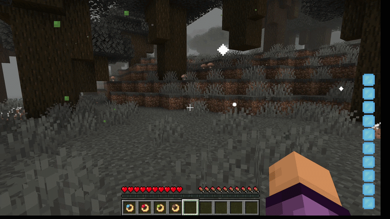
</div>

<hr>

<h3 style="font-size: 20px;" id="necklaces">
    <a href="src/main/java/com/therootsofancientmagic/mixin/HungerManagerMixin.java">Намиста</a>
</h3>

<p style="text-align: justify; font-size: 16px; line-height: 1.7;">
    Намисто працює пасивно, поки одягнене. Також будь-яке намисто не дає голодувати.
</p>

<table style="font-size: 16px; line-height: 1.6;">
  <thead>
    <tr><th>Намисто</th><th>Ефект</th></tr>
  </thead>
  <tbody>
    <tr><td>Вогняне</td><td>Поглинання</td></tr>
    <tr><td>Водяне</td><td>Водне дихання</td></tr>
    <tr><td>Повітря</td><td>Швидкість</td></tr>
    <tr><td>Земляне</td><td>Стрибучість</td></tr>
  </tbody>
</table>

<h3 style="font-size: 20px;" id="necklaces-eng">
    <a href="src/main/java/com/therootsofancientmagic/mixin/HungerManagerMixin.java">Necklaces</a>
</h3>

<details>
  <summary style="font-style: italic; font-size: 14px;">English translation</summary>
  <br>
  <p style="text-align: justify; font-size: 16px; line-height: 1.7;">
      A necklace works passively while worn. Any necklace also prevents hunger.
  </p>
  <table style="font-size: 16px; line-height: 1.6;">
    <thead>
      <tr><th>Necklace</th><th>Effect</th></tr>
    </thead>
    <tbody>
      <tr><td>Fire</td><td>Absorption</td></tr>
      <tr><td>Aqua</td><td>Water Breathing</td></tr>
      <tr><td>Air</td><td>Speed</td></tr>
      <tr><td>Earth</td><td>Jump Boost</td></tr>
    </tbody>
  </table>
</details>
<br>

```java
if (isAirNecklaceInSlot(1)) {
    if (!player.hasStatusEffect(StatusEffects.SPEED)) {
        player.addStatusEffect(new StatusEffectInstance(StatusEffects.SPEED, 210, 0, true, false, false));
    }
}
```

```java
if (hasNecklace) {
    if (this.foodLevel < 22) {
        this.foodLevel = 22;
    }
}
```

<div align="center">
    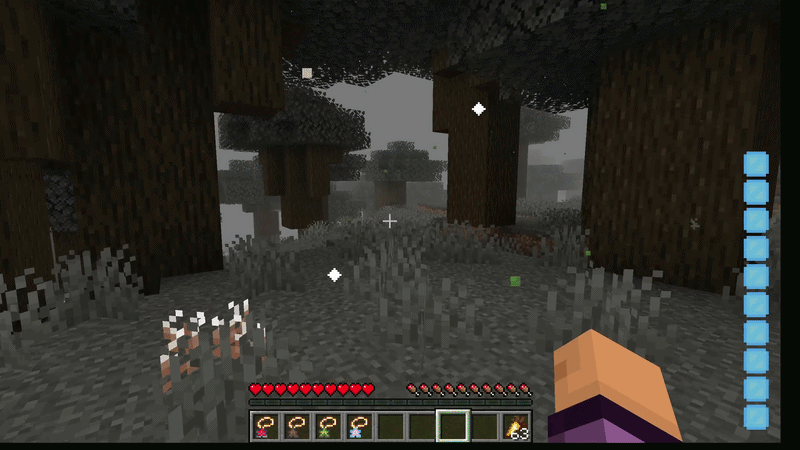
</div>

<hr>

<div align="right">
    <a href="#top">⬆ До початку сторінки</a>
</div>

<br>

<!--  -->

<!--  -->
<h1 id="armor">Броня</h1>

<p style="text-align: justify; font-size: 18px; line-height: 1.7;">
    Повний комплект броні однієї стихії (шолом, нагрудник, поножі, черевики) дає бонус. Перевірка відбувається раз на секунду.
</p>


<h1 id="armor-eng">Armor</h1>

<details>
  <summary style="font-style: italic; font-size: 14px;">English translation</summary>
  <br>
  <p style="text-align: justify; font-size: 18px; line-height: 1.7;">
      A full armor set of one element (helmet, chestplate, leggings, boots) gives a bonus. It is checked once per second.
  </p>
</details>
<br>

<hr>

<h3 style="font-size: 20px;" id="set-bonus">
    <a href="src/main/java/com/therootsofancientmagic/mixin/PlayerTickMixin.java">Бонус повного комплекту</a>
</h3>

<table style="font-size: 16px; line-height: 1.6;">
  <thead>
    <tr><th>Комплект</th><th>Бонус</th></tr>
  </thead>
  <tbody>
    <tr><td>Вогняна</td><td>Вогнестійкість</td></tr>
    <tr><td>Водяна</td><td>Грація дельфіна</td></tr>
    <tr><td>Повітря</td><td>Швидкість I та Стрибучість I</td></tr>
    <tr><td>Земляна</td><td>Поспіх I</td></tr>
    <tr><td>Темна</td><td>Нічний зір</td></tr>
    <tr><td>Світла</td><td>Регенерація II</td></tr>
    <tr><td>Героїчна</td><td>Швидкість, Сила, Поспіх, Нічний зір, Регенерація</td></tr>
  </tbody>
</table>

<h3 style="font-size: 20px;" id="set-bonus-eng">
    <a href="src/main/java/com/therootsofancientmagic/mixin/PlayerTickMixin.java">Full set bonus</a>
</h3>

<details>
  <summary style="font-style: italic; font-size: 14px;">English translation</summary>
  <br>
  <table style="font-size: 16px; line-height: 1.6;">
    <thead>
      <tr><th>Set</th><th>Bonus</th></tr>
    </thead>
    <tbody>
      <tr><td>Fire</td><td>Fire Resistance</td></tr>
      <tr><td>Aqua</td><td>Dolphin's Grace</td></tr>
      <tr><td>Air</td><td>Speed I and Jump Boost I</td></tr>
      <tr><td>Earth</td><td>Haste I</td></tr>
      <tr><td>Dark</td><td>Night Vision</td></tr>
      <tr><td>Light</td><td>Regeneration II</td></tr>
      <tr><td>Heroic</td><td>Speed, Strength, Haste, Night Vision, Regeneration</td></tr>
    </tbody>
  </table>
</details>
<br>

```java
return player.getEquippedStack(EquipmentSlot.HEAD).isOf(helmet)
        && player.getEquippedStack(EquipmentSlot.CHEST).isOf(chestplate)
        && player.getEquippedStack(EquipmentSlot.LEGS).isOf(leggings)
        && player.getEquippedStack(EquipmentSlot.FEET).isOf(boots);
```

<div align="center">
    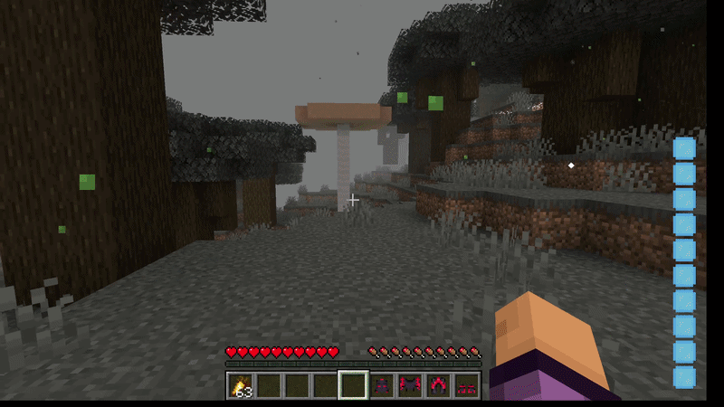
</div>

<hr>

<div align="right">
    <a href="#top">⬆ До початку сторінки</a>
</div>

<br>

<!--  -->

<!--  -->
<h1 id="tools">Інструменти та зброя</h1>

<p style="text-align: justify; font-size: 18px; line-height: 1.7;">
    Для кожної стихії є меч, сокира, кирка, лопата та мотика, а також героїчні версії. Окремо є три унікальні види зброї.
</p>


<h1 id="tools-eng">Tools and Weapons</h1>

<details>
  <summary style="font-style: italic; font-size: 14px;">English translation</summary>
  <br>
  <p style="text-align: justify; font-size: 18px; line-height: 1.7;">
      Every element has a sword, an axe, a pickaxe, a shovel and a hoe, plus heroic versions. There are also three unique weapons.
  </p>
</details>
<br>

<hr>

<h3 style="font-size: 20px;" id="elemental-tools">
    <a href="src/main/java/com/therootsofancientmagic/item/tools/pickaxe/ElementalPickaxeItem.java">Стихійні кирки</a>
</h3>

<p style="text-align: justify; font-size: 16px; line-height: 1.7;">
    Вогняна кирка одразу переплавляє руду. Повітряна та водяна ламають тунель 1×1×3, земляна 3×3, темна та світла 5×5. Також є 5% шанс отримати ефект.
</p>


<h3 style="font-size: 20px;" id="elemental-tools-eng">
    <a href="src/main/java/com/therootsofancientmagic/item/tools/pickaxe/ElementalPickaxeItem.java">Elemental pickaxes</a>
</h3>

<details>
  <summary style="font-style: italic; font-size: 14px;">English translation</summary>
  <br>
  <p style="text-align: justify; font-size: 16px; line-height: 1.7;">
      The fire pickaxe smelts ore instantly. Air and aqua pickaxes break a 1×1×3 tunnel, earth - 3×3, dark and light - 5×5. There is also a 5% chance to get an effect.
  </p>
</details>
<br>

```java
Optional<SmeltingRecipe> recipe = world.getRecipeManager()
        .getFirstMatch(RecipeType.SMELTING, new SimpleInventory(drop), world);

if (recipe.isPresent()) {
    ItemStack cookedResult = recipe.get().getOutput(world.getRegistryManager()).copy();
    cookedResult.setCount(drop.getCount());
    Block.dropStack(world, pos, cookedResult);
}
```

```java
if (this.getMaterial() == ModToolMaturial.ESSENCE_DARK) {
    breakArea(world, pos, player, stack, -2, 2, -2, 2, 0, 0);
}
```

<hr>

<div align="center">
    
</div>

<div align="center">
    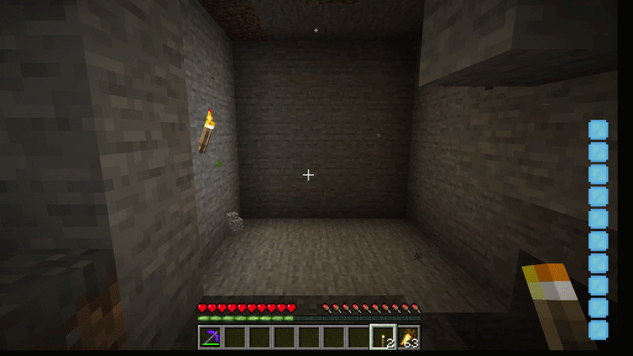
</div>

<hr>

<h3 style="font-size: 20px;" id="battle-axe">
    <a href="src/main/java/com/therootsofancientmagic/item/tools/unique_tools/BattleAxeItem.java">Бойова сокира</a>
</h3>

<p style="text-align: justify; font-size: 16px; line-height: 1.7;">
    Права кнопка: гравець крутиться до 5 с і двічі на секунду б'є всіх навколо (радіус 3,5 блока). Витрачає 10 мани на старті та 5 мани щосекунди, перезарядка 10 с. Під час вміння камера перемикається на вид зі спини.
</p>


<h3 style="font-size: 20px;" id="battle-axe-eng">
    <a href="src/main/java/com/therootsofancientmagic/item/tools/unique_tools/BattleAxeItem.java">Battle Axe</a>
</h3>

<details>
  <summary style="font-style: italic; font-size: 14px;">English translation</summary>
  <br>
  <p style="text-align: justify; font-size: 16px; line-height: 1.7;">
      Right button: the player spins for up to 5 s and hits everyone around twice per second (3.5 block radius). Costs 10 mana on start and 5 mana per second, 10 s cooldown. During the ability the camera switches to the third-person view.
  </p>
</details>
<br>

```java
if (ticksUsed % 10 == 0) {
    List<Entity> targets = world.getOtherEntities(player, searchBox,
            entity -> entity instanceof LivingEntity && entity.distanceTo(player) <= SPIN_RADIUS);

    for (Entity entity : targets) {
        LivingEntity target = (LivingEntity) entity;
        target.damage(world.getDamageSources().playerAttack(player), this.getAttackDamage());
    }
}
```

<div align="center">
    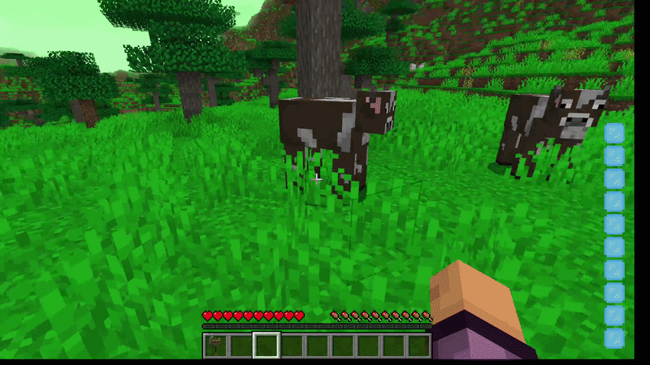
</div>

<hr>

<h3 style="font-size: 20px;" id="lightning-hammer">
    <a href="src/main/java/com/therootsofancientmagic/item/tools/unique_tools/LightningHammerItem.java">Блискавичний молот</a>
</h3>

<p style="text-align: justify; font-size: 16px; line-height: 1.7;">
    Права кнопка (80 мани, перезарядка 5 с) викликає блискавку туди, куди дивиться гравець (до 20 блоків). Удар молотом накладає Слабкість II.
</p>


<h3 style="font-size: 20px;" id="lightning-hammer-eng">
    <a href="src/main/java/com/therootsofancientmagic/item/tools/unique_tools/LightningHammerItem.java">Lightning Hammer</a>
</h3>

<details>
  <summary style="font-style: italic; font-size: 14px;">English translation</summary>
  <br>
  <p style="text-align: justify; font-size: 16px; line-height: 1.7;">
      Right button (80 mana, 5 s cooldown) summons lightning where the player looks (up to 20 blocks). A hit with the hammer applies Weakness II.
  </p>
</details>
<br>

```java
LightningEntity lightning = EntityType.LIGHTNING_BOLT.create(world);
lightning.refreshPositionAfterTeleport(Vec3d.ofBottomCenter(strikePos));
lightning.setChanneler(serverPlayer);
world.spawnEntity(lightning);
```

<div align="center">
    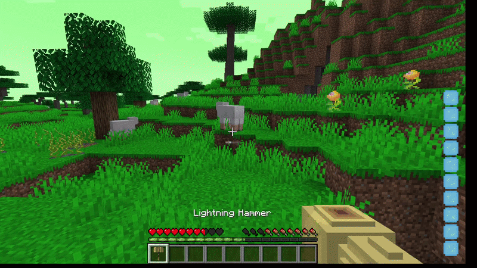
</div>

<hr>

<h3 style="font-size: 20px;" id="necro-scythe">
    <a href="src/main/java/com/therootsofancientmagic/item/tools/unique_tools/NecromancerScytheItem.java">Коса некроманта</a>
</h3>

<p style="text-align: justify; font-size: 16px; line-height: 1.7;">
    Права кнопка (100 мани, перезарядка 15 с) викликає 2 скелетів-візерів, 2 зомбі та скелета з луком. Вони не чіпають господаря, а б'ють тих, кого б'є він. У руках коса дає Нічний зір і Швидкість.
</p>


<h3 style="font-size: 20px;" id="necro-scythe-eng">
    <a href="src/main/java/com/therootsofancientmagic/item/tools/unique_tools/NecromancerScytheItem.java">Necromancer Scythe</a>
</h3>

<details>
  <summary style="font-style: italic; font-size: 14px;">English translation</summary>
  <br>
  <p style="text-align: justify; font-size: 16px; line-height: 1.7;">
      Right button (100 mana, 15 s cooldown) summons 2 wither skeletons, 2 zombies and a skeleton with a bow. They do not touch their master, but attack whoever he attacks. While held, the scythe gives Night Vision and Speed.
  </p>
</details>
<br>

```java
targetSelector.clear(goal -> true);
targetSelector.add(2, new ActiveTargetGoal<>(summon, MobEntity.class, true, (entity) -> {
    if (entity == master || entity == summon) return false;
    return entity.getAttacker() == master || master.getAttacking() == entity;
}));
```

<div align="center">
    
</div>

<hr>

<div align="right">
    <a href="#top">⬆ До початку сторінки</a>
</div>

<br>

<!--  -->

<!--  -->
<h1 id="world">Світ та біоми</h1>

<p style="text-align: justify; font-size: 18px; line-height: 1.7;">
    У світі з'являються 6 нових біомів: dark, light, air, earth, fire та aqua. Вони підключені до Overworld і мають власні кольори, рослинність та квіти стихій.
</p>


<h1 id="world-eng">World and Biomes</h1>

<details>
  <summary style="font-style: italic; font-size: 14px;">English translation</summary>
  <br>
  <p style="text-align: justify; font-size: 18px; line-height: 1.7;">
      6 new biomes appear in the world: dark, light, air, earth, fire and aqua. They are added to the Overworld and have their own colors, vegetation and elemental flowers.
  </p>
</details>
<br>

<hr>

<h3 style="font-size: 20px;" id="biomes">
    <a href="src/main/java/com/therootsofancientmagic/biome/ModBiomes.java">Біоми</a>
</h3>

<p style="text-align: justify; font-size: 16px; line-height: 1.7;">
    Кожен біом це ключ і клас із кольорами неба, води та трави, рослинністю й озерами. До Overworld вони підключаються у файлі <b>overworld.json</b> за температурою.
</p>


<h3 style="font-size: 20px;" id="biomes-eng">
    <a href="src/main/java/com/therootsofancientmagic/biome/ModBiomes.java">Biomes</a>
</h3>

<details>
  <summary style="font-style: italic; font-size: 14px;">English translation</summary>
  <br>
  <p style="text-align: justify; font-size: 16px; line-height: 1.7;">
      Each biome is a key and a class with sky, water and grass colors, vegetation and lakes. They are added to the Overworld in <b>overworld.json</b> by temperature.
  </p>
</details>
<br>

```java
public static final RegistryKey<Biome> DARK = key("dark");
public static final RegistryKey<Biome> FIRE = key("fire");
public static final RegistryKey<Biome> AQUA = key("aqua");
// ...
```

```json
{ "biome": "the-roots-of-ancient-magic:dark",
  "parameters": { "temperature": [-1.0, -0.8], "humidity": [-1.0, 1.0], "continentalness": [-0.19, 1.0] } }
```

<div align="center">
    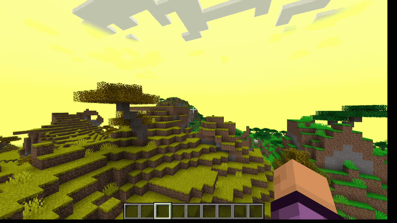
</div>

<div align="center">
    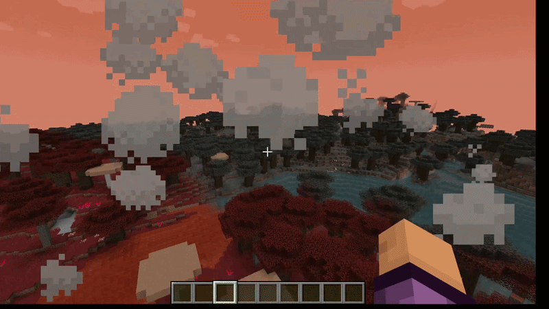
</div>

<div align="center">
    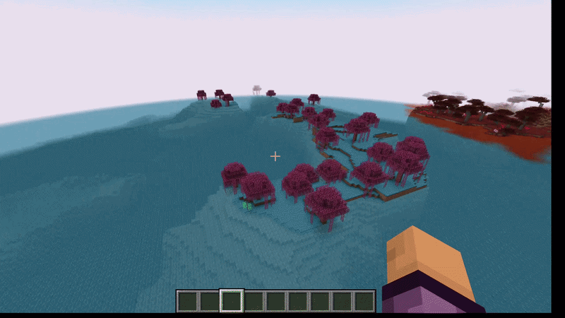
</div>

<div align="center">
    
</div>

<hr>

<h3 style="font-size: 20px;" id="world-flowers">
    <a href="src/main/java/com/therootsofancientmagic/TheRootsOfAncientMagic.java">Квіти у біомах</a>
</h3>

<p style="text-align: justify; font-size: 16px; line-height: 1.7;">
    Кожна квітка стихії додається у свій біом через BiomeModifications.
</p>


<h3 style="font-size: 20px;" id="world-flowers-eng">
    <a href="src/main/java/com/therootsofancientmagic/TheRootsOfAncientMagic.java">Flowers in biomes</a>
</h3>

<details>
  <summary style="font-style: italic; font-size: 14px;">English translation</summary>
  <br>
  <p style="text-align: justify; font-size: 16px; line-height: 1.7;">
      Each elemental flower is added to its own biome via BiomeModifications.
  </p>
</details>
<br>

```java
BiomeModifications.addFeature(
        BiomeSelectors.includeByKey(biomeKey),
        GenerationStep.Feature.VEGETAL_DECORATION,
        flowerKey
);
```

<hr>

<h3 style="font-size: 20px;" id="biome-effects">
    <a href="src/main/java/com/therootsofancientmagic/mixin/BackgroundRendererMixin.java">Ефекти біомів</a>
</h3>

<p style="text-align: justify; font-size: 16px; line-height: 1.7;">
    Біом Earth має туман і вітер на екрані, а Earth, Dark та Fire власні частинки. Туман плавно з'являється й зникає.
</p>


<h3 style="font-size: 20px;" id="biome-effects-eng">
    <a href="src/main/java/com/therootsofancientmagic/mixin/BackgroundRendererMixin.java">Biome effects</a>
</h3>

<details>
  <summary style="font-style: italic; font-size: 14px;">English translation</summary>
  <br>
  <p style="text-align: justify; font-size: 16px; line-height: 1.7;">
      The Earth biome has fog and wind on the screen, while Earth, Dark and Fire have their own particles. The fog smoothly fades in and out.
  </p>
</details>
<br>

```java
boolean isEarth = world.getBiome(pos).getKey().orElse(null).equals(ModBiomes.EARTH);

float target = isEarth ? 1.0F : 0.0F;
earthFog += (target - earthFog) * 0.08F;
```

<div align="center">
    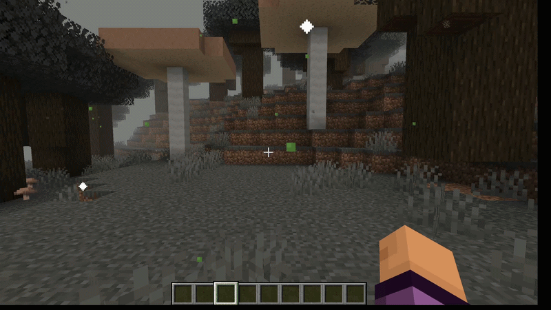
</div>

<div align="center">
    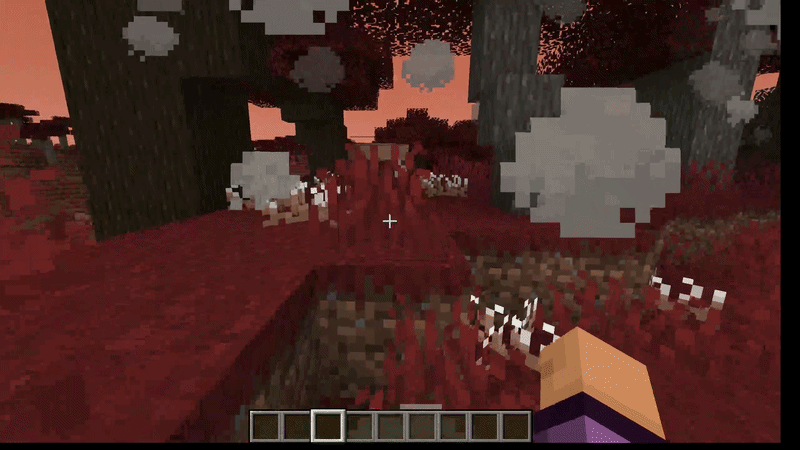
</div>

<hr>

<h3 style="font-size: 20px;" id="datagen">
    <a href="src/main/java/com/therootsofancientmagic/world/ModWordGenerator.java">Генерація даних</a>
</h3>

<p style="text-align: justify; font-size: 16px; line-height: 1.7;">
    Біоми та світові features описані в коді й перетворюються на JSON командою нижче. Результат потрапляє в папку <b>src/main/generated</b>.
</p>


<h3 style="font-size: 20px;" id="datagen-eng">
    <a href="src/main/java/com/therootsofancientmagic/world/ModWordGenerator.java">Data generation</a>
</h3>

<details>
  <summary style="font-style: italic; font-size: 14px;">English translation</summary>
  <br>
  <p style="text-align: justify; font-size: 16px; line-height: 1.7;">
      Biomes and world features are described in code and turned into JSON by the command below. The result goes to the <b>src/main/generated</b> folder.
  </p>
</details>
<br>

```java
entries.addAll(registries.getWrapperOrThrow(RegistryKeys.CONFIGURED_FEATURE));
entries.addAll(registries.getWrapperOrThrow(RegistryKeys.PLACED_FEATURE));
entries.addAll(registries.getWrapperOrThrow(RegistryKeys.BIOME));
```

```bash
./gradlew runDatagen
```

<hr>

<div align="right">
    <a href="#top">⬆ До початку сторінки</a>
</div>

<br>

<!--  -->

<h1 id="result">Висновок</h1>

<hr>

<p style="text-align: justify; font-size: 18px; line-height: 1.7;">
    Під час цього проєкту ми створили мод для Minecraft на Fabric. Він називається The Roots of Ancient Magic. Мод додає в гру магію шести стихій: вогню, води, повітря, землі, темряви та світла.
</p>
<p style="text-align: justify; font-size: 18px; line-height: 1.7;">
    Основа мода система мани. Мана зберігається в даних гравця. Сервер передає її клієнту пакетами. На екрані вона відображається шкалою. На цій системі працюють стихійні посохи, аксесуари, броня та інструменти. Аксесуари це мантії, кільця й намиста з окремими слотами в інвентарі. За повний комплект броні гравець отримує бонус. Також є три унікальні види зброї: бойова сокира, блискавичний молот і коса некроманта.
</p>
<p style="text-align: justify; font-size: 18px; line-height: 1.7;">
    У моді є шість нових біомів. У кожного свої квіти, кольори та візуальні ефекти. Ще додано Пічний порошок і спеціальний стіл крафту з власним типом рецептів.
</p>
<p style="text-align: justify; font-size: 18px; line-height: 1.7;">
    З технічного боку ми працювали з Fabric API та Mixin. Fabric API дає події, пакети, реєстри та генерацію даних. Mixin дозволяє змінювати код самої гри. Через Mixin ми зробили додаткові слоти, збереження мани, бонуси броні та ефекти біомів. Біоми й частину ресурсів ми описуємо в коді. Команда datagen перетворює їх на JSON. Окремо довелося розібратися з меню блоків, зв'язком клієнта із сервером і обробкою клавіш. Мод збирається через Gradle. У режимі розробки він запускається однією командою.
</p>
<p style="text-align: justify; font-size: 18px; line-height: 1.7;">
    Для нашої команди це перший проєкт на Java. Це строго типізована об'єктно-орієнтована мова. До цього ми вивчали її лише на інтенсиві. Одразу після нього ми взялися за дуже складну систему створення модів. Тому результат ми вважаємо хорошим. Ми опанували основи Java та принципи модифікації гри. На іншій версії Minecraft багато що може змінитися: назви класів, API та спосіб реєстрації. Але робити мод для гри, у яку граєш або грав сам, було дуже цікаво.
</p>
<p style="text-align: justify; font-size: 18px; line-height: 1.7;">
    Окремо скажу про команду. Роль тімліда для мене не нова. Проте така велика команда й короткий строк, лише півтора місяця, стали для мене цінним досвідом. З управлінням проблем не було. Усі працювали добре. Завдання вдавалося розподіляти й закривати вчасно. Двоє учасників були зовсім юними, їм 10–12 років. Тому доводилося шукати з ними спільну мову та підтримувати інтерес. Вони й самі були захоплені проєктом. Але їхню увагу треба було фокусувати та уважніше стежити, щоб ніхто не розпорошувався. Це теж став для мене новим і корисним досвідом.
</p>
<p style="text-align: justify; font-size: 18px; line-height: 1.7;">
    Підсумовуючи, ми створили працюючий мод із цілісною магічною системою. Крім того, ми здобули практичні навички командної роботи, поділу великого завдання на частини та роботи зі складними інструментами. Надалі мод можна розширити. Можна додати нові стихії та заклинання, більше рецептів, власних істот і підтримку нових версій гри.
</p>

<h1 id="result-eng">Conclusion</h1>

<details>
  <summary style="font-style: italic; font-size: 14px;">English translation</summary>
  <br>
  <p style="text-align: justify; font-size: 18px; line-height: 1.7;">
      In this project we created a Fabric mod for Minecraft called The Roots of Ancient Magic. The mod adds the magic of six elements to the game: fire, water, air, earth, darkness and light.
  </p>
  <p style="text-align: justify; font-size: 18px; line-height: 1.7;">
      The core of the mod is the mana system. Mana is stored in the player's data. The server sends it to the client in packets. On the screen it is shown as a bar. Elemental staffs, accessories, armor and tools all run on this system. The accessories are robes, rings and necklaces with their own inventory slots. A full armor set gives the player a bonus. There are also three unique weapons: the battle axe, the lightning hammer and the necromancer scythe.
  </p>
  <p style="text-align: justify; font-size: 18px; line-height: 1.7;">
      The mod has six new biomes. Each one has its own flowers, colors and visual effects. We also added the Furnace Powder and a special crafting table with its own recipe type.
  </p>
  <p style="text-align: justify; font-size: 18px; line-height: 1.7;">
      On the technical side we worked with Fabric API and Mixin. Fabric API provides events, packets, registries and data generation. Mixin lets us change the code of the game itself. With Mixin we made the extra slots, mana saving, armor bonuses and biome effects. We describe the biomes and some resources in code. The datagen command turns them into JSON. We also had to figure out block menus, client-server communication and key handling. The mod is built with Gradle. In development mode it runs with one command.
  </p>
  <p style="text-align: justify; font-size: 18px; line-height: 1.7;">
      This is our team's first project in Java. It is a strictly typed, object-oriented language. Before this we had only studied it at the intensive course. Right after it, we took on a very complex modding system. So we consider the result good. We learned the basics of Java and the principles of modifying a game. On another Minecraft version a lot can change: class names, the API and the way things are registered. Still, it was very interesting to make a mod for a game you play or used to play yourself.
  </p>
  <p style="text-align: justify; font-size: 18px; line-height: 1.7;">
      I also want to say a few words about the team. Being a team lead is not new to me. But such a large team and such a short deadline, only one and a half months, was a valuable experience. We had no problems with management. Everyone worked well. We managed to split the tasks and close them on time. Two members were very young, 10–12 years old. So we had to find a common language with them and keep them interested. They were excited about the project themselves. But their attention had to be focused, and we had to watch more closely so that nobody got distracted. This was also a new and useful experience for me.
  </p>
  <p style="text-align: justify; font-size: 18px; line-height: 1.7;">
      To sum up, we created a working mod with a complete magic system. We also gained practical skills in teamwork, splitting a big task into parts and working with complex tools. In the future the mod can be extended. We can add new elements and spells, more recipes, our own mobs and support for newer game versions.
  </p>
</details>
<br>

<hr>

<div align="right">
    <a href="#top">⬆ До початку сторінки</a>
</div>

<hr>
